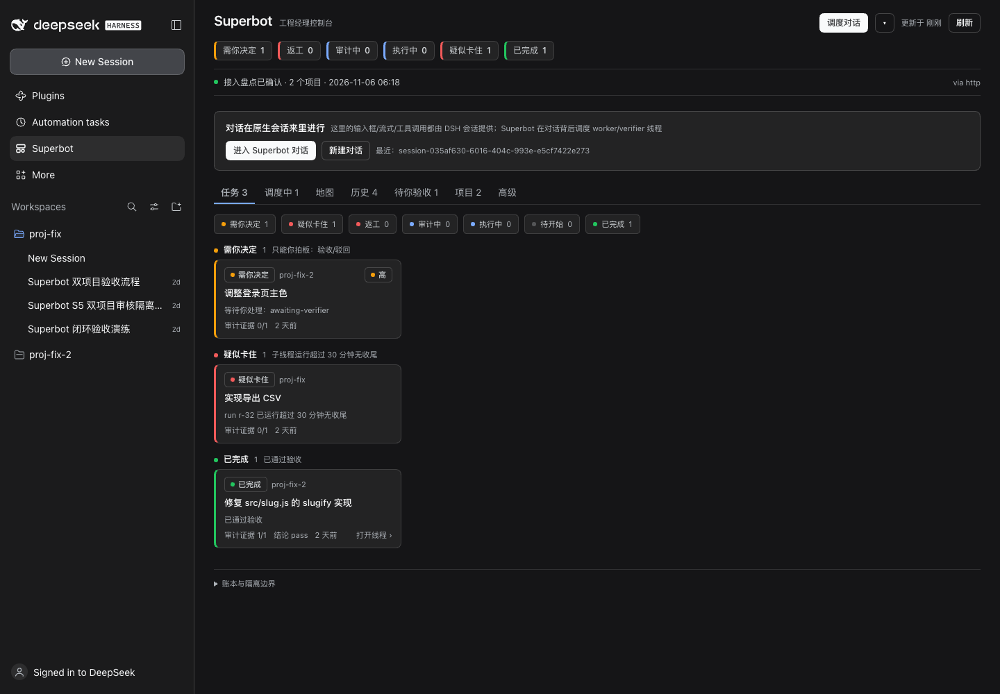
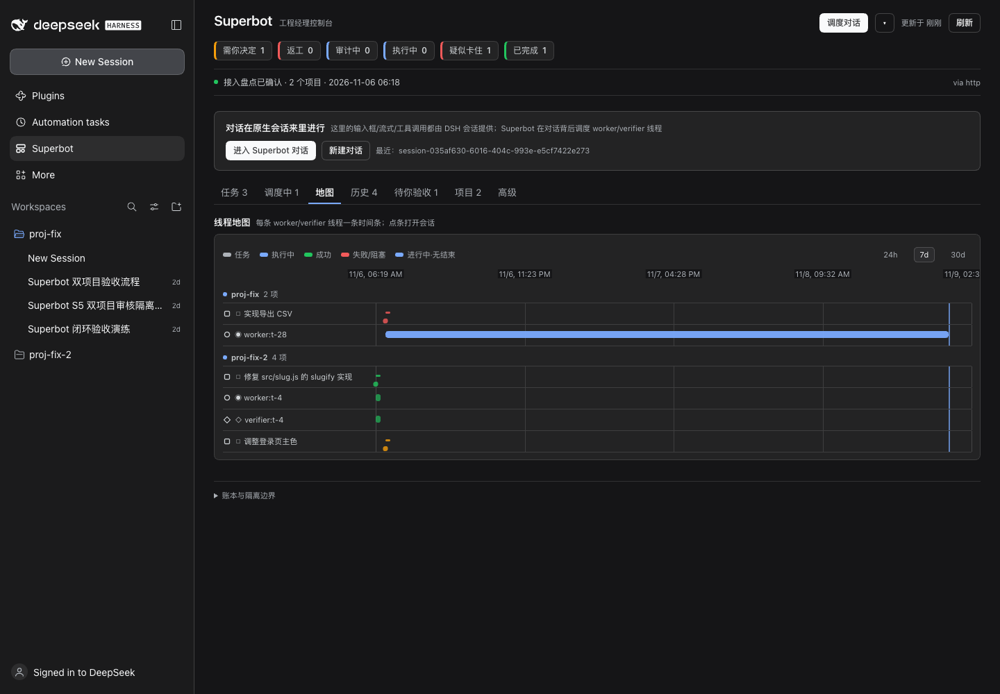

# Superbot · DSH 的核心调度员工

> 你只和 **一个对话窗口** 说话；Superbot 负责把它拆成任务、派给 worker 执行、让 verifier 自动审计、只把**需要你决定**的事交回给你。
> A chief-of-staff agent for DSH: one chat, many projects/threads, ledger-backed tasks and automatic audits.

[](../../actions/workflows/ci.yml)
**149 + 18 tests passing** · MIT · DSH CLI 0.2.1-rc.5 / core 0.2.2-rc.1



## 它解决什么问题

- 你不想逐个项目/线程去填边界、盯进度、替 Agent 验收。
- 你要的是一个**能落地结果**的调度层：需求 → 可验收任务 → 派工 → 机器证据 → 自动审计 → 人工验收/退回 → 返工。
- 装到已经用了几个月的 DSH 上：只读扫描项目/线程，历史工作摘要可一键交给 Superbot 或导入为历史工作项。

## 核心能力

| 能力 | 说明 |
|---|---|
| **单窗口调度** | 一个 Manager 会话管理所有项目的 worker/verifier 子线程；子线程通过账本汇报，不各自聊天 |
| **自动审计** | worker 结束自动派 verifier；verifier 在一次性工作树副本里执行验收命令；低风险+证据齐自动完成，否则转人工 |
| **审核隔离** | worker 自述不算证据；证据绑定 verifier run/childId；固定 argv 白名单；工作区指纹；seq 裁决 |
| **结果仪表盘** | 需你决定 / 返工 / 审计中 / 执行中 / 疑似卡住 / 已完成；线程地图（甘特）+ 任务详情因果时间线 |
| **历史接管** | 旧 DSH 线程摘要、勾选导入、逐条交给 Superbot 分析 |
| **失败闭环** | 人工退回、自动返工 brief、取消、30 分钟卡住检测 |



## 安装

从 [Releases](../../releases) 下载 `dsh-superbot-1.0.0.tgz`（自包含，无第三方依赖）：

```bash
cd "$DSH_HOME/profiles/web"
npm install /abs/path/dsh-superbot-1.0.0.tgz
# profile package.json → dsh.profile.bundles 加入 "dsh-superbot"
DSH_HOME="$DSH_HOME" dsh --profile web --no-open --port 0
```

首次启动：面板 →「首次接入盘点」确认项目状态 → 「进入 Superbot 对话」。

## 架构（为什么它不会变成 Agent 自夸）

```text
用户 ── 一个 Manager 会话（Superbot）── 需求/规格/计划
                       │  dispatch worker / verifier（显式子会话）
                       ▼
             worker 写项目；verifier 只读执行验收命令
                       │  report / evidence / review → 账本（append-only + seq）
                       ▼
              policy 自动裁决 / 人工验收 / 退回返工
```

- 事实源是账本，不是子线程的聊天记忆。
- Manager 无 shell、fs 只读；人类验收默认走宿主 approval（面板直连默认关闭）。
- 验收命令固定白名单；验收在一次性副本执行；证据记录执行模式/沙箱/隔离模式。

## 文档

- [安装/自检](docs/INSTALL.md) · [桌面安装步骤](docs/桌面安装步骤.md) · [上架说明](docs/上架说明-v1.md) · [上架检查表](docs/上架检查表.md)
- [审核隔离与多层级设计](docs/Superbot-审核隔离与多层级设计-v1.md) · [面板设计规范](docs/面板设计规范-v1.md)
- [开关与项目交接](docs/HANDOFF-AND-TOGGLE.md) · [维护手册](docs/MAINTAINER-PLAYBOOK.md) · [Release 记录](reports/v1-release-RELEASE.md)
- 商店素材：[reports/store-v1/](reports/store-v1/)

## 开发

```bash
node --test packages/task-engine/test/*.test.js
node --test packages/dsh-superbot/test/*.test.js
```

无构建步骤：客户端是纯 `React.createElement`，由 DSH 直接加载。

## 反馈与维护

- Bug / 需求：使用 Issue 模板；**先跑 `/superbot/status` 附上 mode/policy/runtime 与 DSH 版本**。
- 我们会把反馈分流为「使用/文档理解问题」与「真实产品缺陷」，见 [维护手册](docs/MAINTAINER-PLAYBOOK.md)。
- 安全漏洞：请走私密 Security Advisory，不要发公开 issue。

## License

MIT
