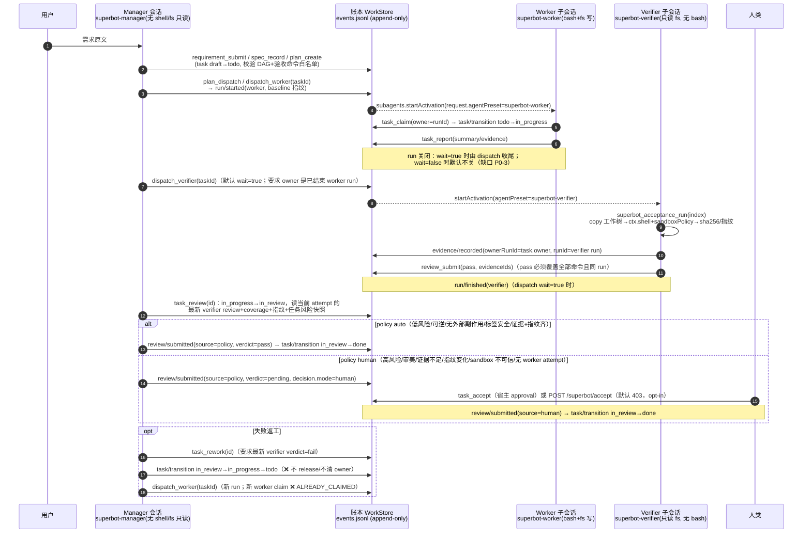

# 专家组 A · 后端调度 / 审计架构复审（backend-logic）

- 日期：2026-11-07（America/New_York）
- 复审对象：`/Users/afraxx/Documents/DeepSeekProjects/superbot-next`（工作树 WIP，HEAD `2dc8df1` + 未提交 S5/S5.1 改动）
- 复审范围：`packages/dsh-superbot/lib/{tools,dispatch-tools,planning-tools,work-store,task-phase,overview,evidence-runner,acceptance-workspace,command-policy,workspace-snapshot,config,index,roles,presets}.js`、`packages/task-engine/lib/index.js`、相关测试与 `README.md`
- 方法：逐文件通读 + 真实运行测试 + 对一个 P0 结论做可复现实验（临时 `stateDir`，只读仓库代码、不写源码）+ 静态追踪所有 `await` 竞态窗口
- 只读约束：未修改任何源码/配置；唯一写入本文件
- 验证基线：`dsh-superbot` **143 pass / 0 fail**；`task-engine` **18 pass / 0 fail**；工作树扫描前后均无新增改动（仅已存在的 WIP）
- 交付物标记：本文件即 task-10 的 ①控制流图 ②问题清单 ③phase 推导 ④面板字段契约；⑤10 行摘要经 `send_message` 发给 Lead

---

## 0. TL;DR（结论）

| # | 结论 | 级别 |
|---|---|---|
| 1 | **rework 闭环是断的**：`superbot_task_rework` 把任务回退到 `todo` 时 **没有清空 `owner`**（旧 worker run id），新 worker 的 `superbot_task_claim` 必然抛 `ALREADY_CLAIMED`。已用 store 级实验复现；现有测试反而断言了 `owner` 仍存在（`dispatch-plan.test.js:228`），没有覆盖 claim | **P0** |
| 2 | **派工入口没有统一的并发准入**：项目单写者 + `wipLimit` 只在 `superbot_plan_dispatch` 内计算；`superbot_dispatch_worker`、`superbot_task_rework` 直接调用同一个 `dispatcher.dispatch()`，绕开项目互斥；prompt-only（无 taskId）派工还能产生**不绑定任务/证据的代码写者** | **P0** |
| 3 | **默认派工会把 run 永久留在 `running`**：`plan_dispatch`/`dispatch_worker` 默认 `wait=false`，返回后不再观察 `activation.result`，子会话结束后 run 不会自动关闭；而 verifier 派工要求"worker run 已结束"，导致 plan→worker→verifier 的主链默认卡死，只能靠 manager 手动 `run_finish`（该步骤不在 persona/brief/phase next 里） | **P0** |
| 4 | **attempt 语义只做了一半**：evidence/review 上已有 `ownerRunId`，但 `task_rework`、`humanWaitReason`、`deriveTaskPhase` 取"最新 verifier 结论"时**不按 attempt 过滤**；`evidenceCoverage`/`taskReview` 对"无 ownerRunId 的旧记录"fail-open。rework 后 UI/决策会混用上一轮 verdict/evidence | P1 |
| 5 | **审计因果链缺关键快照**：policy review 不记录它接受的 verifier review id；human accept 不记录 evidenceIds/coverage/decision/override；report 不校验 task↔run 绑定（已实验：`report.taskId != run.taskId` 也能写入） | P1 |
| 6 | **人类只有"通过"没有"驳回/返工"**：面板文案写"验收/驳回"，但 lib 无 reject 路径；`task_rework` 要求"最新 verifier = fail"，因此"verifier 通过但 policy 判人工"的任务只有 accept 一条路 | P1 |
| 7 | **`task_review` 可在 attempt 运行中执行**：worker/verifier run 仍 active 时也会把任务推进到 `in_review` 并写 policy review，造成"审计结论早于证据/结论覆盖旧证据"的因果倒置；无自动重评估 | P1 |
| 8 | **没有 attempt 实体**：attempt 只能由 worker run 顺序 + `task.owner` 隐式重建；dispatch 失败的 run 也计入 attempts（UI"第 N 次尝试"虚高），rework 新 run 不记录 `reworkOf` | P2 |
| 9 | **phase 推导已有实现但不可全靠**：`task-phase.js` 未按 attempt 过滤；rework 新 worker 执行中仍显示"返工/让 Manager 调用 task_rework"；`in_progress` 无 active run 也显示"审计中"；无 stalled 标记；零单测；面板泳道枚举与 phase 枚举不一致（blocked/canceled 无泳道） | P1（架构交付项） |
| 10 | **死状态 / 缺迁移**：`blocked`、`canceled` 在 task-engine 里允许但无任何工具能触发；`release`（in_progress→todo 清 owner）引擎已有但未接线；无 cancel/abandon/heartbeat | P2 |
| 11 | 账本本身的追加/投影/seq/单实例锁设计是**扎实的**：append-only、seq 定序、投影可重建、O_EXCL 单实例锁、hand-forged transition 拒绝、命令白名单、一键工作树副本 + shell sandbox 证据——这些是本次复审中确认有效的部分（见 §2/§3） | — |

> 一句话：**账本与"审计隔离"层做得比调度层完整**。P0 全部集中在"attempt 生命周期"和"dispatch 准入/收口"两处；把这两处补上，phase/UI 才有可靠事实源。

---

## 1. 复审方法与证据

| 项 | 内容 |
|---|---|
| 代码规模（本次复审相关） | `tools.js` 727、`work-store.js` 1148、`dispatch-tools.js` 493、`planning-tools.js` 332、`task-phase.js` 83、`overview.js` 354、`evidence-runner.js` 150、`task-engine/lib/index.js` 389 行 |
| 单测 | `cd packages/dsh-superbot && node --test test/*.test.js` → **143 pass / 0 fail**（33 suites，~1.8s） |
| 依赖引擎单测 | `cd packages/task-engine && node --test test/*.test.js` → **18 pass / 0 fail** |
| 复现实验（P0-1） | 临时 `stateDir` 下复刻 rework 的两次 transition，再以新 runId claim，得到 `ALREADY_CLAIMED | task t1 is already claimed by r-5`（见附录 A） |
| 复现实验（审计绑定） | `submitReport({taskId:'t2', runId:<t1 的 run>})` 成功写入且 `report.taskId != run.taskId`（见附录 A） |
| 交叉阅读 | `reports/audit-blind-2026-11-06/INTEGRATION.md`（已知 7 个 P0 的修复状态；本轮只报**仍存在/新发现**的问题，并标注差异） |
| 未验证 | 真实 DSH 会话里 worker/verifier 的 actual tool-call 顺序；host `activation.result` 的 stopReason 取值集合（本报告按代码允许值做保守假设） |

---

## 2. 事实模型（账本里的调度对象）

### 2.1 实体与写入者

| 实体 | 账本事件 | 主键 | 谁写 | 说明 |
|---|---|---|---|---|
| requirement | `requirement/created` | `rq-<seq>` | manager | 不可变更 |
| spec | `spec/recorded` | `sp-<seq>` | manager | 不可变更 |
| plan | `plan/created` | `pl-<seq>` | manager | 只引用 taskIds |
| task | `task/created` + `task/transition` | 显式 id 或 `t-<seq>` | manager（计划/评审）、worker（claim） | 状态机在 task-engine |
| run | `run/started` / `run/bound` / `run/finished` | `r-<seq>` | manager（dispatcher） | 一次派工=一个 run=一个 child session |
| report | `report/submitted` | `rp-<seq>` | worker/manager | 只是 claim，不是证据 |
| evidence | `evidence/recorded` | `ev-<seq>` | **仅 verifier run**（结构校验） | 一条=一条声明命令的一次执行 |
| review | `review/submitted` | `rv-<seq>` | verifier tool / manager policy / human surface | `source: verifier|policy|human` 决定校验强度 |
| inventory | `inventory/confirmed` | `inv-<seq>` | 人类（approval/HTTP opt-in） | 首次接入盘点 |

写入点：task/run/report/review/evidence 全在 `work-store.js`（`#append` 见 `work-store.js:498-518`）；事件 kind 清单 `work-store.js:40-57`；信封 `{schemaVersion,seq,kind,at,actor,reason}`。

### 2.2 定序与"最新"语义

- 唯一顺序是 append `seq`（`work-store.js:500-508`）；投影重建只认 seq/schemaVersion（`work-store.js:264-368`）。
- review/evidence 记录都把 `seq` 写进实体（`work-store.js:954-955`、`774-776`），`listReviews` 用 `compareBySeq`（`work-store.js:234-243,890-894`）——这点是对的。
- **但** `listEvidence` 按 `createdAt` 字符串排序而非 seq（`work-store.js:734-738`）；`listRuns` 按 `startedAt` + `runId` 字典序（`work-store.js:627-631`），`r-10` 会排在 `r-9` 前。同毫秒/同秒并发时"latest"可能取错（P2-1）。
- `taskReview` 的 `latest = verifierReviews.at(-1)` 依赖上述排序；tests 覆盖了 review 同时间戳按 seq（`review-isolation.test.js:243-252`），但没有覆盖 evidence/run 的排序退化。

### 2.3 attempt（轮次）当前如何被表达

账本里**没有 attempt 实体**。目前 attempt 由三个字段隐式拼出：

```
attempt := task.owner                  // worker 在 child session 里 claim 时写入的 owner（设计上=本次 worker runId）
evidence.ownerRunId                    // 记录 evidence 时刻的 task.owner（work-store.js:771-772,781）
review.ownerRunId / reviewedOwner      // 记录 review 时刻的 task.owner（work-store.js:961,968）
```

- 正向：verifier 的 `acceptance_run`/`review_submit` 用 `exec.agent.id` → `store.findRunByChildId(childId,{taskId,agentPreset})` 反查 run，**不接受模型传 runId**（`tools.js:465-471,560-566`；`work-store.js:633-644`）——这是很关键的结构性防伪。
- 缺口：没有 `attemptNo` 字段；dispatch 失败/未 bind child 的 run 也会被算一次 attempt；新 attempt 的 run 不记录 `reworkOf`；review/evidence 不记录 `taskVersion`（evidence 有，`work-store.js:782`；review 没有）。

---

## 3. 现状控制流（真实调用链）

### 3.1 主链（成功路径）



### 3.2 实际状态迁移表（含触发者与代码位置）

| from → to | 触发 | 代码 | owner 处理 |
|---|---|---|---|
| draft → todo | `superbot_task_plan` / `plan_create` | `work-store.js:583-588,1117-1119` | — |
| todo → in_progress | worker `superbot_task_claim`（owner=runId） | `work-store.js:590-595`；engine `196-204` | 设 owner |
| in_progress → in_review | manager `superbot_task_review` | `tools.js:177-179`；`work-store.js:597-602` | 保留 owner |
| in_review → done（policy） | `task_review` 自动验收 | `tools.js:254-278`；engine `374-389` | **清 owner**（engine `190-191`） |
| in_review → done（human） | `task_accept` / HTTP accept | `tools.js:315-319`；`work-store.js:981-997`；engine `346-372` | **清 owner** |
| in_review → in_progress | `task_rework`（rework-start） | `dispatch-tools.js:473-475` | 保留旧 owner |
| in_progress → todo | `task_rework`（rework-requeue） | `dispatch-tools.js:476-478` | ❌ **保留旧 owner** = P0-1 根因 |
| todo → blocked / canceled 等 | **无任何工具可达** | `task-engine:35-43` 允许，但没有 tool 触发 | — |
| in_progress → todo（release） | 引擎 `release()` 存在但**未接线** | `task-engine:206-211`；`work-store.js` 无 releaseTask | 会清 owner（但没人调用） |

结论：调度状态机里 **10 条允许的迁移没有可达工具**（`draft→canceled`；`todo→blocked/canceled`；`in_progress→blocked/canceled`；`in_review→canceled`；`blocked→todo/in_progress/canceled`），而唯一能清 owner 的 `release` 没被 rework 使用。这是 P0-1 的直接原因。

### 3.3 自动 vs 人工决策边界（现状）

| 决策 | 谁做 | 代码 | 事实来源 |
|---|---|---|---|
| 是否派 worker | Manager（agent） | `dispatch-tools.js:254-360`、`planning-tools.js:276-330` | 账本 task/deps/run/盘点 |
| worker 尝试的完成状态 | **Manager 手动** `run_finish`（wait=false 时） | `tools.js:436-452`；`dispatch-tools.js:342` | ⚠️ 不是宿主观察值，是 manager 自报 |
| 验收证据 | Verifier 子会话执行声明命令 | `tools.js:453-546`；`evidence-runner.js` | 机器 exitCode + 指纹 |
| verifier 结论 | Verifier 子会话 | `tools.js:547-584`；`work-store.js:909-974` | 结构性要求 evidenceIds/coverage |
| policy 裁决 | `task_review`（账本逻辑，manager 触发） | `tools.js:163-290` | task 快照 + attempt review/evidence/指纹 |
| 人类放行 | Host approval / HTTP(opt-in) | `tools.js:291-321`；`index.js:316-333` | 人 |
| 返工 | Manager（要求 verifier fail） | `dispatch-tools.js:443-491` | 账本 |

> 关键观察：**"自动审计"不是宿主后台调度，而是 manager 会话按 brief/persona 逐次调用工具**。没有常驻 reconciler；manager 不推进，任务就停在原地。`task-phase`/overview 是纯读投影，不产生动作。这一点对 phase 的"next step"字段设计要求很高（必须机器可读地告诉谁该做什么）。

---

## 4. 审计因果完整性审计（attempt / evidence / verdict / policy / human）

### 4.1 期望的因果链

```
task(attempt N) → dispatch run(worker,N,baseline) → claim(owner=runId)
  → report(runId) → run/finished(succeeded|failed)
  → dispatch run(verifier,N) → evidence[i](runId=verifier, ownerRunId=workerRun, index, exitCode, digest, workspaceDigest)
  → review(verifier,N, runId, evidenceIds, verdict, reviewedOwner, ownerRunId)
  → review(policy,N, verifierReviewId, evidenceIds, decision{mode,reasons}, reviewedOwner, ownerRunId)
  → task/transition(done)  (actor=policy)  或  review(human,N, evidenceIds, decision, override) → done(actor=human)
```

### 4.2 当前绑定/顺序检查表

| 因果环节 | 结构校验（现在有没有） | 代码 | 结论 |
|---|---|---|---|
| attempt → worker run | `task.owner` 被当成 attempt runId；`taskReview` 校验 run.agentPreset/taskId | `tools.js:180-187` | ⚠️ **没有校验 run.status/childId/report**；manager 自报 owner 字符串不能成为 attempt |
| worker run → report | 无：`submitReport` 只要求 taskId/runId 各自存在，**不校验两者一致** | `work-store.js:710-726` | ❌ 已实验：report 可挂到别的 task 的 run（附录 A） |
| worker 交付 → verifier 派工 | verifier 派工要求 owner 是 finished worker run | `dispatch-tools.js:235-243` | ✅ 有 gate；但"finished"= `!isRunActive`，failed 也算 finished |
| evidence → verifier run | run 必须属于该 task、preset=verifier、childId 匹配、命令必须等于账本声明、exitCode 整数 | `work-store.js:749-803` | ✅ 结构很强 |
| evidence → attempt | `ownerRunId = task.owner` 写入；覆盖统计按 `ownerRunId === task.owner` 过滤 | `work-store.js:771-772,805-837` | ⚠️ **旧记录无 ownerRunId 时 fail-open 被计入**（`:813-815`） |
| evidence → review | pass 必须带 evidenceIds；每条 evidence 属于同 task、同 verifier run；且覆盖每个声明命令 | `work-store.js:919-946` | ✅ 强；但 coverage 是提交 review 时刻按"当前 owner"重算，review 不落 coverage 快照 |
| latest verdict | `listReviews` 按 seq；`taskReview` 过滤 `source==='verifier'` + attempt（含 fail-open） | `tools.js:188-192` | ⚠️ `review.ownerRunId === undefined` 的旧记录对所有 attempt 放行（`:189`） |
| policy → verifier review | taskReview 只取"最新 verifier review"评估，但 policy review **不记录所评估的 reviewId/attempt** | `tools.js:256-268`；`work-store.js:953-971` | ❌ 无法从账本重建"policy 接受了哪条 verdict"；之后若有新 review，因果不可考 |
| policy → done | policy review（seq n）先 append，再 `commitAccepted` transition（seq n+1） | `tools.js:256-270`；`work-store.js:608-613` | ✅ 顺序正确；但事件 kind 被统一写成 `task/transition`，引擎的 `task/accepted-by-policy` 被丢弃（`work-store.js:569-580`） |
| human → evidence/decision | human review 不带 evidenceIds、不带 coverage/decision/override | `work-store.js:984-994` | ❌ 审计无法知道人看到了什么、覆盖了哪些阻塞原因 |
| review 重放/伪造 | verifier review 不看 reviewId 参数，从 `exec.agent.id` 反查 run；verifier pass 不可复用旧 evidence/session | `tools.js:560-582`；`work-store.js:923-929` | ✅ 结构性防重放 |
| hand-forged transition | 投影要求 from 连续 + version+1 | `work-store.js:289-303` | ✅ 测试覆盖（`review-isolation.test.js:457-469`） |

### 4.3 顺序（seq）审计：自动路径与人工路径的实际事件序

自动路径（`tests/review-isolation.test.js:203-220` 覆盖）：

```
… task/transition(in_progress→in_review)      ← taskReview 第一步，无条件执行
    review/submitted(source=policy, verdict=pass, decision.mode=auto)
    task/transition(in_review→done, actor=policy, task.acceptedBy=policy)
```

人工路径（`review-isolation.test.js:444-455`）：

```
… task/transition(in_progress→in_review)
    review/submitted(source=policy, verdict=pending, decision.mode=human)
    review/submitted(source=human, verdict=pass, reviewedOwner=workerRun)
    task/transition(in_review→done, actor=human, task.acceptedBy=human, acceptanceVia=host-approval)
```

问题不在 append 顺序（都是正确的因果序），而在**因果元素的缺失**：policy 不知道"我评的是哪条 verifier review"、human 不知道"我覆盖了哪些 blocker"、AI 无法从账本重建"人为什么通过"。这会让 UI 的"审计到哪一步/因果关系"只能靠再推导，且推导结果会随新 review 追加而漂移。

### 4.4 rework 后的旧证据/旧 verdict 隔离（重点审计）

当前隔离依赖"`task.owner` 指向当前 attempt"这一隐式约定：

- **正常情况**：rework 后新 worker claim 会覆盖 `task.owner`（新 runId），于是 `evidenceCoverage` 只统计新 ownerRunId 的 evidence，`taskReview` 只取新 attempt 的 verifier review（`work-store.js:809-816`；`tools.js:188-189`）。
- **实际情况（P0-1）**：rework 不释放 owner，新 worker claim 直接失败，`task.owner` 永远停在旧 runId → 旧 evidence/旧 verdict **一直被视为当前 attempt**；如果子会话"硬着头皮"继续干活，它写下的 evidence 也会被记到**旧 attempt**（`ownerRunId` 取旧 owner），审计归属直接错乱。
- **升级/老账本情况**：`ownerRunId === undefined` 的旧 evidence/review 在"attempt 已存在"时**不被过滤**（`work-store.js:813-815`；`tools.js:189`）→ 旧证据可以满足新 attempt 的 coverage，旧 pass 可被当最新 verdict。
- **跨 attempt 的最新判定**：`task_rework` 自己只做 `listReviews().filter(verifier).at(-1)`（`dispatch-tools.js:465-470`），**没有 attempt 过滤**；`humanWaitReason`（`overview.js:36-45`）与 `task-phase`（`task-phase.js:44-48`）同样不按 attempt。→ rework 之后、新 attempt 尚无 verifier 结论时，"最新 verifier verdict"仍是上一轮的 fail，UI 会持续显示"返工/让 manager 再次 rework"（已实测，见附录 A），而 `task_rework` 又因任务已是 todo 拒绝执行。

**结论：rework 隔离目前只在"claim 成功"的窄路径上成立；P0-1 使其破防，老账本 fail-open 是第二层破防。**

### 4.5 审计自动化"卡住 / 误判"条件清单

| # | 条件 | 现在会发生什么 | 证据 | 级别 |
|---|---|---|---|---|
| S1 | rework 后新 worker claim | 抛 `ALREADY_CLAIMED`；run 悬挂；任务停在 todo（旧 owner） | `dispatch-tools.js:473-486`；engine `196-198` | **P0** |
| S2 | `plan_dispatch`/`dispatch_worker` 默认 `wait=false` | 子会话结束后 run 仍 running；verifier 派工报 `has no finished worker attempt`；主链停 | `planning-tools.js:309-316`；`dispatch-tools.js:342,235-243` | **P0** |
| S3 | worker crash / 网络断（claim 后无 report） | run 永久 running；rework 被"active run"挡住；dispatch 被"unfinished run"挡住 | `dispatch-tools.js:245-248,463-464`；`work-store.js:62-65` | P1 |
| S4 | verifier crash（部分 evidence 后） | run 悬挂；无 review；rework 被 active run 挡；需手动 `run_finish` | 同上 + `tools.js:465-471` | P1 |
| S5 | 任务没有 `acceptanceCommands` | verifier 永远无法 pass（coverage.complete=false），只能 fail/pending → rework 死循环；或 human 手工通过 | `work-store.js:805-837`；`work-store.js:930-946` | P1 |
| S6 | rework 的 requeue 已发生、dispatch 在 `requireOnboarding`/project 状态处失败 | 任务停在 todo（旧 owner），工具报"requeued but dispatch failed"；无自动回滚 | `dispatch-tools.js:473-489`；`dispatch-tools.js:259-266` | P1 |
| S7 | attempt 运行中调用 `task_review` | 任务提前进 in_review；policy review 基于不完整证据；verifier 之后 pass 也不会自动重评估 | `tools.js:171-180`（无 active-run gate） | P1 |
| S8 | 旧账本记录无 `ownerRunId` | 旧 evidence/review 对新 attempt 生效（升级后自动验收可能用旧证据） | `work-store.js:813-815`；`tools.js:189` | P1 |
| S9 | verifier pass 之后又来了新的（失败）evidence（同 attempt，新 verifier run） | `taskReview` 用最新 review=pass，但 coverage 取最新 evidence；若最新 failed 则 blocked（正确）；若新 evidence passed 但 review evidenceIds 不含它，仍会按"latest review pass + complete coverage"接受（review→evidence 绑定被稀释） | `tools.js:190-192,243` | P2 |
| S10 | 多条验收命令的 evidence 在不同工作树状态下产生 | `digests.has(current)` 只要求"任一 evidence digest 匹配"，不是全部匹配 → TOCTOU 可漏 | `tools.js:236-240` | P2 |
| S11 | `stopReason` 非 error 的异常（取消/中断） | `runStatusOf` 只有 error→failed，其余→succeeded；账本记成功 | `dispatch-tools.js:56-60` | P2 |
| S12 | 同一个 task 被两个 manager 会话操作 | 大多数同步写是安全的；但 approval 双开、`task_accept` 双开会出现"人批了但第二次报错"；`run_finish` 与 `acceptance_run` 可交错（见 §5.3） | `tools.js:299-320`；`tools.js:453-546` | P2 |

---

## 5. 问题清单（P0 / P1 / P2）

> 级别定义：**P0** = 主链必然/高概率卡死或事实错误，且没有工具内自救路径；**P1** = 审计因果/隔离不完整或存在明确竞态，可能导致误验收或人工死路；**P2** = 数据/契约/一致性问题，影响面板正确性或长期可维护性。
> 每条给：证据（file:line）→ 影响 → 修法（含测试建议）。

### P0

#### P0-1 rework 后旧 owner 未释放 → 新 worker 无法 claim，返工闭环断裂
- 证据：
  - `dispatch-tools.js:473-478`：`in_review→in_progress→todo` 只用 `store.transitionTask`；`task-engine/lib/index.js:190-191` 只在 `done/canceled` 清 owner；`claim()` 在 `task-engine/lib/index.js:196-198` 对非 null owner 抛 `ALREADY_CLAIMED`。
  - 实验复现（附录 A）：`after rework requeue: status=todo | owner=r-5` → `attempt2 claim FAILED: ALREADY_CLAIMED`。
  - 现有测试 `dispatch-plan.test.js:214-229` 只断言 `workerRuns.length===2` 和 `owner != undefined`（`:228`），**把"owner 仍存在"当成预期**，没有模拟 claim。
- 影响：返工派出的 worker 第一步就失败；run 悬挂；任务停在 todo；`task_rework` 又要求 `in_review/in_progress`（`dispatch-tools.js:460-462`），无工具可恢复 → 任务永久卡死；后续 evidence 会被记到旧 attempt（owner 未变），审计归属错乱。
- 修法：
  1. `work-store.js` 增加 `releaseTask(id,{owner,actor})` 包装引擎 `release()`（`task-engine:206-211`），在 rework-requeue 用它替代裸 `transitionTask(...,'todo')`；
  2. 或在 `transition()` 对 `in_progress→todo` 统一清 owner（引擎层，影响面大，建议用 release 包装）；
  3. 把 `task_rework` 拆成"前置校验（含 dispatch 准入预检）→ 状态回退 → 派工"三步，失败时回滚/留可恢复态（见 P1-6）；
  4. 回归测试：`taskRework` → 从新 run 的 child session 调 `task_claim({owner:<新 runId>})` 必须成功；并断言 `task.owner === 新 runId`、`evidenceCoverage` 过滤掉旧 evidence。
- 参考修法（最小 diff）：

```js
// work-store.js
releaseTask(id, { owner, actor = 'manager', reason = 'release', at } = {}) {
  const task = this.#requireTask(id)
  const { release } = taskEngine // 现有 import 里补 release
  const result = release(task, { owner, at })
  return this.#commitTransition(result.task, result.event, { reason, actor })
}
// dispatch-tools.js task_rework
if (task.status === 'in_review') store.transitionTask(id, 'in_progress', { actor: 'manager', reason: 'rework-start' })
store.releaseTask(id, { owner: task.owner, reason: 'rework-requeue' })   // → todo，owner=null
```

#### P0-2 派工入口无统一准入：项目单写者 / WIP 上限可被直连工具绕过，且存在"无任务写者"
- 证据：
  - `dispatch-tools.js:221-252` 的 `precheckTask` 只检查**该 task 自身**是否已有 active run；没有任何 project/wip 维度的检查。
  - 项目互斥/WIP 只存在于 `planning-tools.js:287-306`（`selectDispatchBatch` + `runningByProject`），也就是**只有 plan_dispatch 有**。
  - `superbot_dispatch_worker`（`dispatch-tools.js:422-432`）与 `superbot_task_rework`（`:479-486`）都直接调 `dispatcher.dispatch`，绕过 plan 层 → 同一项目可被两个 worker 同时写。
  - `dispatch()` 允许 `taskId` 省略（`:262-268`）：worker preset 有 bash+fs 写（`presets.js:121-139`），因此 manager 可以派一个**完全不绑定任务/证据**的"写者"，只留下一个 taskId=null 的 run（overview 里显示为 `—` 线程）。
  - README:72 声称"同一项目同时只允许 1 个 worker（task-engine 项目互斥 + config.wipLimit）"——只在 plan 路径成立。
- 影响：违反 AGENTS「一个项目同时一个写者」与 wipLimit；文件冲突/覆盖；无任务的写入不进任务/证据账本，破坏"账本是事实来源"；多 manager 会话并发时 `plan_dispatch` 也会因"先算 batch 再 await 派工"出现跨调用重复占用同项目（见 §5.3 竞态 R2）。
- 修法：
  1. 在 `createDispatcher` 内实现唯一准入函数 `admitDispatch({kind, task, project})`：扫描 `store.listRuns({})` 的 active runs → 同项目已有 worker（或广义 active child）→ 拒绝并返回 reason（`project-busy`）；全局 worker 数 ≥ `config.wipLimit` → `wip-limit`；
  2. worker 派工**强制 taskId**（`taskId === undefined && kind==='worker'` → 抛错）；如确需侦察类无任务派工，另开 verifier/只读 spec，或显式 `unbound:true` 并禁止 worker preset；
  3. `plan_dispatch` 不再自己算互斥，只把准入 reason 映射为 `skipped`（单一事实来源）；
  4. 测试：直接 `dispatch_worker` 两个同项目 todo 任务 → 第二个必须拒绝；rework 派工也受同一校验；无 taskId 的 worker 派工必须拒绝。

#### P0-3 默认派工不观察子会话结果 → run 永 running，主链默认卡死
- 证据：
  - `dispatch-tools.js:342`：`if (args.wait !== true) return base` 直接返回，`activation.result` 没有被 attach 任何 continuation；
  - `planning-tools.js:309-316`：plan dispatch 只在显式 `wait:true` 时才传；默认 false；
  - verifier 派工前置要求 owner 是**已结束** worker run（`dispatch-tools.js:235-243`），因此 plan→worker→verifier 的默认路径会在 verifier 派工时失败；
  - README:229-232 承认"run 会一直是 running，需要 manager 显式 run_finish 关闭"，但：manager persona/brief 都没有教它这一步（`presets.js:37-50`；`dispatch-tools.js:80-184`）；`task-phase` next 从不提示 run_finish（`task-phase.js:74-79`）；UI 也没有 run_finish 按钮。
- 影响：正常使用时账本把"已完成"显示成"执行中/审计中"（phase 不推进），verifier 无法派工；只能靠 manager 临场发现 `run_finish` 工具自救。这是"结果导向面板"的最大事实源风险。
- 修法（推荐组合）：
  1. `dispatch()` 在 `wait!==true` 时 attach 后台收口：
     ```js
     const settle = (fn) => { try { fn() } catch { /* best effort */ } }
     Promise.resolve(activation.result).then(
       (result) => settle(() => store.finishRun(run.runId, { status: runStatusOf(result), summary: summarizeActivationResult(result), actor: 'manager', reason: 'dispatch-result' })),
       (error) => settle(() => store.finishRun(run.runId, { status: 'failed', summary: String(error?.message ?? error), actor: 'manager', reason: 'dispatch-failed' })),
     )
     ```
     （注意 `run_finish` 可能已被人调用：`finishRun` 会抛 `already …`，被 `settle` 吞掉即可。）测试：fake host 返回 deferred `result`，dispatch(wait=false) 立即返回 run running；resolve 后 run 自动 succeeded；
  2. 或把 plan dispatch 默认改为 `wait:true`（简单但串行、慢）；
  3. `runStatusOf` 改为白名单：`completed→succeeded`，`error→failed`，其他（aborted/canceled/timeout）→ `canceled`/`failed`（`dispatch-tools.js:56-60`）；
  4. phase 增加 `stalled` 标记：active run 年龄 > `config.runStaleAfterMs`（新增，默认 15min）时，`next` = `{owner:'manager', action:'run_finish', tool:'superbot_run_finish', runId}`。

### P1

#### P1-1 attempt 作用域不一致：rework / UI / policy 取"最新 verdict"时混轮次
- 证据：
  - `dispatch-tools.js:465-470`（task_rework）：全量 verifier reviews 的 `.at(-1)`，无 attempt 过滤；
  - `overview.js:36-45`（humanWaitReason）：同上；
  - `task-phase.js:44-48`：同上；
  - `tools.js:188-189`：attempt 过滤允许 `review.ownerRunId === undefined` 的旧记录；
  - `work-store.js:813-815`：coverage 允许 `evidence.ownerRunId === undefined` 的旧证据。
- 影响：rework 后旧一轮 fail/pass 继续驱动 UI/返工判断（附录 A 实测：新 worker 运行期间 phase 仍为 rework，next 仍让 manager 调 task_rework）；升级账本可能把旧证据/旧 pass 计入新 attempt → 误自动验收。
- 修法：在 `work-store` 提供唯一 `attemptView(taskId)`（见 §6.4 参考实现），产出 `{attemptRun, attemptNo, evidence, reviews, coverage}`；`taskReview`、`task_rework`、`humanWaitReason`、`task-phase`、overview 全部改用该视图；严格规则：`attemptRunId` 存在时 **只认 `ownerRunId === attemptRunId`**，无 ownerRunId 的旧记录视为 `legacy-unbound`（只能人工验收，不能参与 auto/pass 判定）；`attemptRunId` 不存在（尚未 claim）时 coverage 视为空。补测试：构造 attempt1 fail + attempt2 进行中，断言 task_rework 拒绝、phase=executing、coverage 只统计 attempt2。

#### P1-2 policy review 缺少"被评估对象"快照 → 因果链不可重建
- 证据：`tools.js:256-268` 只写 `evidenceIds/decision/reviewedOwner/source`；`work-store.js:953-971` 无 `verifierReviewId/attemptRunId/taskVersion/coverage snapshot`。
- 影响：审计/UI 无法回答"policy 接受的是哪条 verifier verdict"；之后追加的 review 会让"最新"漂移，回放无法重现当时判决。
- 修法：policy review 增加：
  ```js
  { verifierReviewId: latest?.reviewId, verifierReviewSeq: latest?.seq,
    attemptRunId: attemptRun?.runId ?? null, taskVersion: reviewed.version,
    coverage: { commandCount, passed, complete, evidenceIds: [...], workspaceDigest } }
  ```
  字段可选、向后兼容；`taskReview` 与 `work-store.submitReview` 同步改；测试断言 policy review 能精确指向 verifier review 与 evidence 集合。

#### P1-3 human accept 不留证据/决策/override 快照
- 证据：`work-store.js:984-994` human review 只有 `verdict:'pass', notes`；`tools.js:308-313` approval reason 只报"证据 x/y"；`index.js:328` HTTP accept 同样不带 decision。
- 影响：面板"人为什么通过/覆盖了哪些 blocker"无法审计；高风险任务的人工放行与普通放行不可区分。
- 修法：`acceptTaskByHuman` 在事务内先取 `coverage`/最新 verifier review/最新 policy review，写 review 时带 `evidenceIds`、`decision:{mode:'human', reasons: policy?.decision?.reasons ?? []}`、`override: latestVerifier?.verdict==='fail' ? 'verifier-fail' : (latestPolicy?.decision?.mode==='human' ? 'policy-human' : undefined)`、`coverage snapshot`；approval `reason` 同样带上 blocking reasons（避免人盲批）。

#### P1-4 没有人类"驳回/返工"路径（只有通过）
- 证据：`roles.js:78-96` 无 reject/cancel 工具；`tools.js`/`work-store.js` 无 reject 方法；`dispatch-tools.js:465-470` `task_rework` 硬性要求"最新 verifier = fail"，因此"verifier pass 但 policy 因风险/审美/指纹/无 worker attempt 判人工"的任务**无法退回 worker**；面板文案 `client.js:879` 写"验收/驳回"、`client.js:506-560` 的 AttentionRow 只有"通过验收"。
- 影响：人类不同意时只能被迫 accept 或让 manager 手工绕过；与"验收权在人"的设计相反。
- 修法：新增 `superbot_task_reject`（manager 调用 → 宿主 approval 由人批准 → `work-store.rejectTaskByHuman(id,{note})`）：
  - 记 `review/submitted(source='human', verdict='fail', notes, evidenceIds/decision snapshot, override)`；
  - 状态 `in_review → in_progress → todo` 并用 `releaseTask` 清 owner（依赖 P0-1 修法）；
  - 记录 `reason='human-reject'`、`rejectedBy` 字段；
  - 可选：返回后由 manager 调 `task_rework` 或直接 `dispatch_worker`（rework 失败路径同样要支持 todo+最新 human fail）。
  面板在 approval-only 模式下同样提供"驳回"入口（走 manager 工具 + approval）；测试覆盖 reject 后新 worker 可 claim。

#### P1-5 `task_review` 不检查 attempt 是否仍在运行 → 因果倒置
- 证据：`tools.js:171-180` 仅校验 `status in (in_progress,in_review)`；未检查 `store.listRuns({taskId}).some(isRunActive)`。
- 影响：manager 可以在 worker/verifier 正在跑时调用，任务提前进 in_review 并写入 policy review（基于不完整证据）；之后 verifier 继续写 evidence/ review，任务状态/判决与证据时间线错位；若人此时 accept，会造成"验收发生在证据完成前"（且 P2-2 的 run 可能还在跑）。
- 修法：入口 fail-closed：
  ```js
  const active = store.listRuns({ taskId: task.id }).filter(isRunActive)
  if (active.length > 0) throw new Error(`attempt still running (${active.map(r=>r.runId).join(',')}); collect the run before evaluation`)
  ```
  （若产品需要"边跑边预评审"，另开只读 `task_audit` 而不是写 policy review。）补测试：active worker/verifier 时 task_review 必须拒绝。

#### P1-6 worker attempt 绑定与 report 校验缺口
- 证据：
  - `work-store.js:710-726` `submitReport` 只 `requireTask/requireRun`，**不校验 run.taskId===taskId、run.agentPreset、childId**；实验中 `t2` 的报告可挂到 `t1` 的 run（附录 A）；
  - `tools.js:185-187` `attemptIsWorkerRun` 只校验 `run.agentPreset==='superbot-worker' && run.taskId===task.id`，**不校验 run 已结束/childId/report**；
  - `tools.js:146-162` `task_claim` 的 owner 完全由模型传入；若 worker 传错（不是自己的 runId），`attempt=owner` 找不到 run → `no-worker-attempt` 强制人工，且没有修复工具（rework 要求 verifier fail，可能拿不到）。
- 影响：审计链"worker 真的交付过"依赖模型自觉；错误 owner 会把任务带进人类死路；report 可张冠李戴。
- 修法：
  1. `submitReport` 校验：`runId` 存在时 `run.taskId===taskId` 且 preset ∈ {worker,verifier}；`taskId` 存在时若 `runId` 缺省不阻断；记录 `attemptRunId`（= runId）与 seq；
  2. `attemptIsWorkerRun` 加：`!isRunActive(attemptRun)` + `typeof attemptRun.childId==='string'`；可选要求 `attemptRun.status==='succeeded'`（至少不把 failed 当成功尝试）；
  3. `task_claim`：若 `exec.agent.id` 能解析出 worker run（`findRunByChildId`）则强制 `owner=run.runId`（不再信任参数）；worker brief 里保留展示；无 run 时允许 legacy 路径但记录 `claimedVia:'param'` 供审计；
  4. 测试：错绑 report 必须拒绝；worker claim 用错 owner 被纠正；claim 后 `task.owner` 必须等于该 child 的 run。

#### P1-7 无 run 租约/心跳/自动收口 → stale run 会长期占据调度闸门
- 证据：`work-store.js:62-65` `isRunActive = !terminal`；无心跳事件；`dispatch-tools.js:245-248,463-464,235-243` 以 active run 为闸门；README:229-232 承认依赖人工 `run_finish`；`task-phase.js:41-43,74-75` 只要 active 就显示 executing/auditing。
- 影响：宿主崩溃/子会话异常造成 run 永 running → 调度、返工、验证全部被挡；UI 显示"执行中"但事实可能已死；无自动恢复。
- 修法：
  1. 短期（本次可做）：`task-phase` 加 `stalled` + next 指向 `run_finish`；`overview.pendingHuman`/`openTasks` 加 `stalled` 标记；manager persona 明确"发现 stale run 先 run_finish 再重派"；
  2. 中期：新增可选 `config.runStaleAfterMs`；`run/started` 记录 `attemptNo/expectedChild`；由 manager 每轮/面板轮询计算 stale（不新增常驻定时器）；
  3. 长期：宿主提供 child liveness 后做 reconciler（当前不假设）。

#### P1-8 无 `acceptanceCommands` 的任务会被永久困在"自动验收不可达"
- 证据：`tools.js:63-73` `acceptanceCommands` 可选；plan schema 同样可选（`:204-215`）；`work-store.js:805-837` `complete` 要求 `rows.length>0`；`taskReview` 因此永远 `verification-not-passed`（`tools.js:243`）；`task-phase` 对 in_review 只给 generic "证据已齐/等待人工"（`:76`）。
- 影响：verifier 只能 fail/pending，manager 可能无限 rework；面板无法区分"证据不足待补"与"该走人工验收（无机器命令）"；任务事实对不齐。
- 修法：把"验收模式"显式化：`task.acceptanceMode = commands.length>0 ? 'machine' : 'manual'`（推导字段，不落库亦可）；`plan_create`/`task_submit` 在缺少 commands 时要求显式 `manualAcceptance:true` 才允许（或强 warning 返回）；`taskReview` policy 对 manual 任务直接 `mode:human reasons:['manual-acceptance']`；phase `awaiting-human` reason `manual-acceptance`；禁止对 manual 任务派 verifier（`dispatch-tools.js:precheckTask` 增加 kind=verifier 的 `task.acceptanceCommands.length>0`，或提示改为人工）。测试：manual 任务派 verifier 被拒/或 task_review 一次就转人工而不是可 rework。

### P2

| # | 问题 | 证据 | 影响 / 修法 |
|---|---|---|---|
| P2-1 | evidence/run 的"latest"排序不用 seq：`listEvidence` 用 `createdAt`（`work-store.js:734-738`），`listRuns` 用 `startedAt`+runId 字典序（`:627-631`） | 同毫秒/`r-10` vs `r-9` 时 latest 取错 | 统一按 seq（evidence 有 seq；run 需在 `run/started` 里加 seq 或解析数字 runId），并加排序单测 |
| P2-2 | `taskReview` 的工作区指纹校验是"任一 evidence digest 匹配即可" | `tools.js:236-240` | 多条命令在不同树状态下产生的证据可漏过 TOCTOU；改为"所有当前 attempt 最新 evidence 的 workspaceDigest 必须一致且等于 current.digest" |
| P2-3 | 重复调用 `task_review` 会不断追加 policy review（无幂等/无评估 token） | `tools.js:256-268` | 审计噪音、"最新 policy"漂移；加 `evaluationKey = sha256(taskVersion+attemptRunId+evidenceIds+verifierReviewId)` 去重，或只允许状态/证据变化后重评 |
| P2-4 | `finishRun` 不校验 status 枚举、`runStatusOf` 误判 | `work-store.js:681-694`；`dispatch-tools.js:56-60` | 任何字符串都能写入账本；取消/超时记成功；收窄为枚举 + stopReason 白名单映射 |
| P2-5 | 事件 kind 丢失：policy/human 接受被统一写成 `task/transition` | `work-store.js:568-580,608-613,995`；`task-engine:362-371,379-388` | 原始审计无法从 kind 区分 accepted-by-policy/human；把引擎 event 的 kind/reason 落进 payload 或改用独立 kind（schemaVersion 兼容） |
| P2-6 | `?projectId=` 过滤 overview 时：projects/totals/attention 过滤了，但 `tasks` 返回全量 | `overview.js:271-311,318-336`；实验：`projectId=ws-2` → tasks `['t2','t1']` | 面板/外部 API 契约错误；`tasks` 也应按 projectId/filter/q 过滤，或明确 `tasks` 永远是全局 |
| P2-7 | phase 枚举与面板泳道不一致：`blocked/canceled` 无泳道，`needs-you` 不在 task-10 phase 列表 | `task-phase.js:17-26`；`client.js:878-888`（fallback `PHASE_LANES[4]`） | blocked/canceled 任务在任务板"消失/被当 queued"；补泳道或映射 |
| P2-8 | `deriveTaskPhase` 依赖外部注入 `pendingReason`，不自包含 | `task-phase.js:39,68-70`；`overview.js:267-280` | 同账本状态在不同调用点得到不同 phase（in_review+verifier fail：overview 注入→needs-you，直接调用→rework）；把 policy/human 判定内置进 derive |
| P2-9 | dispatch 失败的 run 也被算一次 attempt；无 `reworkOf/attemptNo` 落库 | `task-phase.js:49`（`worker runs` 全算）；`work-store.js:646-668` 无 attempt 字段；`dispatch-tools.js:479-486` 只把 reworkOf 放在工具返回值 | UI"第 N 次尝试"虚高、审计无法从账本知道"这是返工第几轮、因谁而返"；run/started 增加 `attemptNo/reworkOfReviewId`（可选字段） |
| P2-10 | 无 `attemptNo`/`attemptRunId` 的 review/evidence 查询接口；overview 只在 task 行给 flattened `thread`（任一 preset，可能是 verifier） | `overview.js:271-310`；`task-phase.js:44-49` | 面板无法展示"每次尝试→证据→结论"链条；新增 task audit 视图（§7） |
| P2-11 | `task_review` 先 transition 后计算；若中途异常会留下"in_review 但无 policy review" | `tools.js:177-179` 之后才有 `submitReview`/`commitAccepted`（`:256-278`） | 崩溃窗口可恢复（重试），但状态与判决有个空隙；可先计算/写 review 再 transition（注意 policy review 需要 in_review 语义），或记录 `review/pending` 事件 |
| P2-12 | evidence `preview`/`outputPath` 原样入账并可被 `superbot_audit_export` 导出 | `work-store.js:789-791`；`tools.js:596-608` | 测试输出可能含 token/密钥；默认落 digest+脱敏 preview 或限制 export 权限（仅 manager/verifier 已限，风险低） |
| P2-13 | 文档漂移：README 工具表缺 `superbot_task_rework`；测试计数"18 文件/143 断言"（实际 16 个 test 文件/143 用例）；尾部仍称"verifier 不能执行验收命令，可由 manager 执行"（与 D1/acceptance_run 相反） | `README.md:68-77,200,234-238`；实际 `wc -l test/*.test.js`（16 个 .test.js） | 误导后续维护/验收；同步文档 |

### 竞态/并发窗口（补充，按严重度）

| # | 窗口 | 机制 | 结果 | 修法 |
|---|---|---|---|---|
| R1 | `acceptance_run` await shell 期间 manager `run_finish` | 工具在命令执行前检查 run running（`tools.js:469-471`），命令执行后可 `recordEvidence` 不看 run 状态（`work-store.js:749-803`） | 已关闭 run 仍能写 evidence；review_submit 也不看 run running（`work-store.js:924-929`）。审计出现"关闭后的证据" | `recordEvidence`/`submitReview` 要求 verifier run `status==='running'`（或记录 `recordedAfterRunClose` 标记并降级为人工） |
| R2 | 两个 `plan_dispatch` 并发（两个 manager 会话） | 各自先算 batch 再 await 派工（`planning-tools.js:285-320`）；虽然单个 task 由 precheck+startRun 同步块保护，但项目互斥是算出来的快照 | 可能跨调用出现同项目两个 active worker（实际受 startRun 顺序影响，不能完全排除） | P0-2 的准入集中化后自动消失 |
| R3 | `task_review` 与 verifier 运行并发 | 无 active run guard（P1-5） | in_review/ policy review 早于 verdict；证据追加后不自动重评 | P1-5 guard + phase 提示 |
| R4 | 双 manager 会话同时 `task_accept` | `acceptTaskByHuman` 先写 review 再 transition（`work-store.js:984-996`）；没有幂等键 | 第二个 approval 被用户允许后报 `NOT_REVIEWABLE`（体验差），且可能留下第二条 human review 若时序更巧 | `acceptTaskByHuman` 先检查 in_review 再写 review（当前顺序是先 submitReview 后 transition；改为先 transition 再 review 或加 token），并返回明确"已由他人验收" |
| R5 | `task_rework` 两次并发 | 第一次 transition 后 dispatch 前无 await；第二次读状态可能仍是 todo（第一次已改）→ 第二次要求 in_review/in_progress → 拒绝；基本安全 | 安全 | 补测试固化 |

> 并发总结：**进程级只有一个 JS 线程 + 单实例文件锁（`work-store.js:162-232`）**，没有多进程写账本问题；真正的风险都在"长 await 期间状态被另一条工具链改写"（R1/R3/R4）。同步"读-判-写"块（claim/startRun/taskReview/rework 状态回退）本身是原子的。

---

## 6. 结果导向 phase：从账本唯一推导

### 6.1 目标 phase 定义（对 UI 的语义契约）

| phase | 语义（用户看到的一句话） | 是否等待外部动作 | 下一步责任人 |
|---|---|---|---|
| `queued` | 已计划，还没派工 | Manager | Manager 派工 |
| `executing` | worker 正在做（含返工后的第 N 次尝试） | worker | 等 worker 交付 / Manager 收 run |
| `auditing` | 已交付，verifier/policy 正在检查证据 | verifier/manager | 等证据/结论 / Manager 裁决 |
| `awaiting-human` | 需要人拍板（验收/驳回） | 人 | 人（approval/面板 opt-in） |
| `rework` | 最近一轮验收失败，等待新一次尝试 | Manager | Manager 重新派工 |
| `done` | 已通过验收（policy 或 human） | — | — |
| `blocked` | 没有可执行的下一步（缺命令/项目不可解析/stale run/任务被标阻塞） | Manager/人 | 见 reasonCode |
| `canceled` | 已取消 | — | — |

> 与原 `needs-you` 的兼容：建议服务端保留 `phase:'awaiting-human'`，同时给 `legacyPhase:'needs-you'` 或让面板把两者视为同一泳道；`blocked/canceled` 必须补泳道（P2-7）。

### 6.2 现状 `deriveTaskPhase` 审计（`lib/task-phase.js:39-83`）

| # | 缺陷 | 证据 | 后果 |
|---|---|---|---|
| 1 | verifier reviews 不按 attempt 过滤 | `task-phase.js:44-45` | rework 后旧 fail 继续当"最新"（实测：新 worker 运行中 phase=rework） |
| 2 | rework 判定先于 active worker 判定 | `:71-75`（rework 在 activeWorker 之前） | 返工执行中显示"返工/让 manager 再调 task_rework"（下一步错误，重复返工） |
| 3 | `in_progress` 无 active run 一律 `auditing` | `:77-80` | "等待派工"也显示"审计中"；语义不真 |
| 4 | `in_review` 未注入 pendingReason 时直接 `auditing` 且文案"证据已齐" | `:76` | 证据可能不齐仍称齐；phase 依赖调用方补参数（P2-8） |
| 5 | `pendingReason` 先于 verifier fail 判定 | `:68-70` | in_review+verifier fail 显示"需你决定"（提示人验收/驳回，但实际应返工）；且面板无驳回 |
| 6 | `audit.latestVerdict` 取全部 attempt | `:44-45,60` | UI 结论字段可能来自旧 attempt |
| 7 | `attempts` 把 dispatch 失败 run 也算一次 | `:49` | "第 N 次尝试"虚高 |
| 8 | 无 `stalled`、无机器可读 reasonCode/next action | `:51-63` | 面板只能展示自然语言；无法驱动"谁下一步做什么" |
| 9 | 零单测 | `grep -rn deriveTaskPhase test/` → 无命中 | 该函数是 UI 事实源却完全没有测试（只经 overview 间接） |

### 6.3 推荐 phase 决策表（唯一事实源，按优先级短路）

> 输入只用账本：`task + runs + reviews + evidence(+coverage)`；`now` 由调用方注入（便于测试）。

| 顺序 | 条件 | phase | reasonCode | next（机器可读） |
|---:|---|---|---|---|
| 1 | `task.status==='done'` | done | accepted-policy / accepted-human | `{actor:'none'}` |
| 2 | `task.status==='canceled'` | canceled | canceled | `{actor:'none'}` |
| 3 | `task.status==='blocked'` | blocked | task-blocked | `{actor:'manager', action:'unblock'}` |
| 4 | 当前 attempt 有 **active verifier run** | auditing | verifier-running / verifier-run-stalled | `{actor:'verifier'}` 或 stale 时 `{actor:'manager', action:'run_finish'}` |
| 5 | 当前 attempt 有 **active worker run** | executing | worker-running / rework-running（attemptNo>1）/ worker-run-stalled | `{actor:'worker'}` 或 stale 时 manager run_finish |
| 6 | 最新 attempt verifier verdict = `fail` | rework | verification-failed | `{actor:'manager', action:'rework', tool:'superbot_task_rework'}` |
| 7 | `status==='in_review'` 且 policy decision.mode=`human` | awaiting-human | policy-human（+第一个 blocker code） | `{actor:'human', action:'accept-or-reject'}` |
| 8 | `status==='in_review'` 且无 policy review / policy pending | auditing | awaiting-policy | `{actor:'manager', action:'evaluate', tool:'superbot_task_review'}` |
| 9 | `status==='in_review'` 且无 verifier 结论 | awaiting-human | awaiting-verifier / evidence-incomplete | `{actor:'manager', action:'dispatch-verifier'}`（或 blocked，如果项目不可解析） |
| 10 | `status==='in_progress'` 且 verifier pass+coverage complete | auditing | awaiting-policy | manager task_review |
| 11 | `status==='in_progress'` 且无 active run、无 verifier 结论 | auditing | worker-delivered-awaiting-verifier | manager dispatch_verifier |
| 12 | `status==='in_progress'` 且 verifier fail | rework | verification-failed | manager task_rework |
| 13 | `status∈{todo,draft}` 且存在上一轮 fail | rework | requeued-after-fail / stale-owner（若是坏状态） | manager：修复 owner/重派 |
| 14 | `status∈{todo,draft}` | queued | planned / awaiting-dispatch | manager plan_dispatch |
| 15 | 缺 `acceptanceCommands` 且任务非 done | awaiting-human（或 blocked） | manual-acceptance / no-acceptance-commands | `{actor:'human', action:'accept-manual'}` |
| 16 | 项目不可解析（project-unresolved） | blocked | project-unresolved | manager：重新映射/挂起项目 |
| 17 | 其它 | blocked | unknown-state | manager |

### 6.4 参考实现（proposed `lib/task-phase.js` V2，未提交）

```js
// 纯函数；输入全部来自 WorkStore，now/staleAfterMs 可注入以便测试。
export const PHASE = Object.freeze({
  queued: 'queued', executing: 'executing', auditing: 'auditing',
  awaitingHuman: 'awaiting-human', rework: 'rework', done: 'done',
  blocked: 'blocked', canceled: 'canceled',
})
const WORKER = 'superbot-worker'
const VERIFIER = 'superbot-verifier'
const ACTIVE = (run) => run !== undefined && !['succeeded', 'failed', 'canceled'].includes(run.status)
const seqOf = (row) => (Number.isInteger(row?.seq) ? row.seq : 0)
const bySeq = (a, b) => seqOf(a) - seqOf(b) || String(a.submittedAt ?? '').localeCompare(String(b.submittedAt ?? ''))
const runSeq = (run) => Number(String(run?.runId ?? '').replace(/^r-/, '')) || 0
const byRun = (a, b) => String(a.startedAt ?? '').localeCompare(String(b.startedAt ?? '')) || runSeq(a) - runSeq(b)

/**
 * 一个任务当前 attempt 的唯一视图：worker run + 该 attempt 的 report/evidence/review/coverage。
 * 严格绑定：ownerRunId 必须等于 attemptRunId；无 ownerRunId 的旧记录标记 legacyUnbound，不参与 auto。
 */
export function attemptView({ task, runs = [], reviews = [], evidence = [], reports = [], now = Date.now(), staleAfterMs = 15 * 60_000 }) {
  const taskRuns = runs.filter((run) => run.taskId === task.id).sort(byRun)
  const workerRuns = taskRuns.filter((run) => run.agentPreset === WORKER)
  const ownerRun = task.owner ? taskRuns.find((run) => run.runId === task.owner) : undefined
  const attemptRun = (ownerRun && ownerRun.agentPreset === WORKER ? ownerRun : undefined)
    ?? workerRuns.filter((run) => typeof run.childId === 'string').at(-1)
    ?? workerRuns.at(-1)
  const attemptRunId = attemptRun?.runId ?? null
  const attemptNo = attemptRun === undefined ? 0 : workerRuns.findIndex((run) => run.runId === attemptRunId) + 1

  const belongs = (row) => attemptRunId !== null && row.ownerRunId === attemptRunId
  const taskReviews = reviews.filter((review) => review.taskId === task.id).sort(bySeq)
  const taskEvidence = evidence.filter((row) => row.taskId === task.id).sort(bySeq)
  const attemptReviews = taskReviews.filter(belongs)
  const attemptEvidence = taskEvidence.filter(belongs)
  const legacyUnbound = {
    reviews: taskReviews.filter((review) => review.ownerRunId === undefined && review.source !== 'policy' && review.source !== 'human'),
    evidence: taskEvidence.filter((row) => row.ownerRunId === undefined),
  }

  const commands = Array.isArray(task.acceptanceCommands) ? task.acceptanceCommands : []
  const rows = commands.map((entry, index) => {
    const evidenceRow = attemptEvidence.filter((row) => row.index === index).at(-1)
    return {
      index, command: entry.command, expectedExitCode: entry.expectExitCode ?? 0,
      evidenceId: evidenceRow?.evidenceId ?? null, exitCode: evidenceRow?.exitCode ?? null,
      passed: evidenceRow !== undefined && evidenceRow.timedOut !== true && evidenceRow.exitCode === (entry.expectExitCode ?? 0),
    }
  })
  const coverage = {
    commandCount: rows.length,
    hasCommands: rows.length > 0,
    complete: rows.length > 0 && rows.every((row) => row.passed),
    rows,
  }
  const verifierReviews = attemptReviews.filter((review) => review.source === 'verifier')
  const policyReviews = attemptReviews.filter((review) => review.source === 'policy')
  const humanReviews = attemptReviews.filter((review) => review.source === 'human')
  const activeRuns = taskRuns.filter(ACTIVE)
  const stale = (run) => {
    if (!ACTIVE(run)) return false
    const started = Date.parse(run.startedAt ?? '')
    return Number.isFinite(started) && now - started > staleAfterMs
  }
  return {
    task, workerRuns, attemptRun, attemptRunId, attemptNo,
    reports: attemptRunId === null ? [] : reports.filter((report) => report.runId === attemptRunId).sort(bySeq),
    reviews: attemptReviews, legacyUnbound,
    evidence: attemptEvidence,
    coverage,
    latestVerifier: verifierReviews.at(-1) ?? null,
    latestPolicy: policyReviews.at(-1) ?? null,
    latestHuman: humanReviews.at(-1) ?? null,
    activeWorker: activeRuns.find((run) => run.agentPreset === WORKER) ?? null,
    activeVerifier: activeRuns.find((run) => run.agentPreset === VERIFIER) ?? null,
    staleRuns: activeRuns.filter(stale),
  }
}

export function deriveTaskPhaseV2(input) {
  const view = attemptView(input)
  const { task, coverage, latestVerifier, latestPolicy, latestHuman } = view
  const AUDIT_END = { evidencePassed: coverage.rows.filter((row) => row.passed).length, evidenceTotal: coverage.rows.length, latestVerdict: latestVerifier?.verdict ?? null, attempts: view.attemptNo }
  const out = (phase, reasonCode, reason, next, blockers = []) => ({
    phase, reasonCode, reason, next, blockers,
    audit: { ...AUDIT_END, state: phase === 'done' || phase === 'awaiting-human' || phase === 'rework' ? 'finished' : phase === 'auditing' ? 'running' : 'not-started' },
    attemptNo: view.attemptNo,
    stalled: view.staleRuns.length > 0,
    stalledRunIds: view.staleRuns.map((run) => run.runId),
  })
  const managerRunFinish = (run) => ({ actor: 'manager', action: 'run_finish', tool: 'superbot_run_finish', runId: run.runId })
  const policyReasons = Array.isArray(latestPolicy?.decision?.reasons) ? latestPolicy.decision.reasons : []
  const manualAcceptance = coverage.hasCommands === false
  const failReview = latestVerifier?.verdict === 'fail'

  if (task.status === 'done') return out(PHASE.done, latestHuman ? 'accepted-human' : 'accepted-policy', '已通过验收', { actor: 'none' })
  if (task.status === 'canceled') return out(PHASE.canceled, 'canceled', '任务已取消', { actor: 'none' })
  if (task.status === 'blocked') return out(PHASE.blocked, 'task-blocked', '任务被阻塞', { actor: 'manager', action: 'unblock' })

  if (view.activeVerifier) {
    return out(PHASE.auditing, 'verifier-running', 'verifier 正在执行验收命令', view.staleRuns.includes(view.activeVerifier) ? managerRunFinish(view.activeVerifier) : { actor: 'verifier', action: 'wait' })
  }
  if (view.activeWorker) {
    const code = view.attemptNo > 1 ? 'rework-running' : 'worker-running'
    return out(PHASE.executing, code, view.attemptNo > 1 ? `第 ${view.attemptNo} 次尝试执行中` : 'worker 正在执行任务', view.staleRuns.includes(view.activeWorker) ? managerRunFinish(view.activeWorker) : { actor: 'worker', action: 'wait' })
  }
  if (failReview && (task.status === 'in_review' || task.status === 'in_progress')) {
    return out(PHASE.rework, 'verification-failed', '最近一次自动审计未通过', { actor: 'manager', action: 'rework', tool: 'superbot_task_rework' })
  }
  if (task.status === 'in_review' || task.status === 'in_progress') {
    if (latestPolicy?.decision?.mode === 'human' || (manualAcceptance && task.status === 'in_review')) {
      const code = manualAcceptance ? 'manual-acceptance' : (policyReasons[0] ?? 'policy-human')
      return out(PHASE.awaitingHuman, code, manualAcceptance ? '该任务没有机器验收命令，只能人工验收' : `策略要求人工验收：${policyReasons.join(', ') || 'high-risk'}`, { actor: 'human', action: 'accept-or-reject' }, policyReasons)
    }
    if (latestPolicy === null) {
      // 还没被 policy 评估
      if (latestVerifier?.verdict === 'pass' && coverage.complete) {
        return out(PHASE.auditing, 'awaiting-policy', '证据已齐，等待 manager 触发账本裁决', { actor: 'manager', action: 'evaluate', tool: 'superbot_task_review' })
      }
      if (task.status === 'in_review') {
        return out(PHASE.awaitingHuman, manualAcceptance ? 'manual-acceptance' : 'awaiting-verifier', '还没有可用的 verifier 结论/完整证据', { actor: 'manager', action: 'dispatch-verifier', tool: 'superbot_dispatch_verifier' })
      }
    }
    if (latestVerifier === null) {
      return out(PHASE.auditing, 'worker-delivered-awaiting-verifier', 'worker 已交付，等待 verifier 执行自动审计', { actor: 'manager', action: 'dispatch-verifier', tool: 'superbot_dispatch_verifier' })
    }
    if (latestVerifier.verdict === 'pass' && !coverage.complete) {
      return out(PHASE.auditing, 'evidence-incomplete', 'verifier 结论存在但证据未覆盖全部命令', { actor: 'manager', action: 'redispatch-verifier', tool: 'superbot_dispatch_verifier' })
    }
    return out(PHASE.auditing, 'awaiting-policy', '等待账本裁决', { actor: 'manager', action: 'evaluate', tool: 'superbot_task_review' })
  }
  if (task.status === 'todo' || task.status === 'draft') {
    if (failReview) {
      const staleOwner = task.owner !== null && task.owner !== undefined
      return out(PHASE.rework, staleOwner ? 'stale-owner' : 'requeued-after-fail',
        staleOwner ? '返工排队状态异常：旧 attempt 仍占 owner（需修复后重派）' : '上一轮失败，等待重新派工',
        { actor: 'manager', action: 'rework-retry', tool: 'superbot_dispatch_worker' },
        staleOwner ? [{ code: 'stale-owner', owner: String(task.owner) }] : [])
    }
    return out(PHASE.queued, 'planned', '已计划，尚未派工', { actor: 'manager', action: 'dispatch', tool: 'superbot_plan_dispatch' })
  }
  return out(PHASE.blocked, 'unknown-state', `未知任务状态 ${String(task.status)}`, { actor: 'manager', action: 'inspect' })
}
```

> 落地顺序建议：先修 P0-1/P0-3 + `attemptView`（P1-1），再替换 `task-phase`（保留旧函数导出以兼容），最后接 UI 新字段（§7）。所有 phase 分支都可由上表条件在账本上复算，不依赖 UI 记忆。

### 6.5 phase 测试矩阵（必须补，当前 `task-phase.js` 零测试）

| 场景 | 期望 phase / reasonCode / next.actor |
|---|---|
| draft/todo，无 run | queued / planned / manager |
| todo，上一轮 verifier fail（正常 requeue） | rework / requeued-after-fail / manager |
| todo，上一轮 fail 且 owner 残留（P0-1 坏态） | rework / stale-owner / manager |
| active worker run（第 1 次） | executing / worker-running / worker |
| active worker run（第 2 次） | executing / rework-running / worker |
| active verifier run | auditing / verifier-running / verifier |
| in_progress，无 active run，无 verifier | auditing / worker-delivered-awaiting-verifier / manager |
| verifier pass + coverage complete，未 policy | auditing / awaiting-policy / manager |
| verifier fail | rework / verification-failed / manager |
| in_review + policy human（风险/审美） | awaiting-human / policy-human 或 tag code / human |
| in_review + 无 acceptanceCommands | awaiting-human / manual-acceptance / human |
| in_review + 无 verifier 结论 | awaiting-human / awaiting-verifier / manager |
| active run 年龄 > staleAfterMs | executing|auditing + stalled=true；next=run_finish |
| done（policy/human） | done / accepted-* / none |
| canceled/blocked | canceled/blocked |
| 旧账本 evidence/review 无 ownerRunId + 新 attempt | 不得参与 auto；phase 走人类/审计分支（legacy-unbound） |

---

## 7. 给面板的字段契约（每个任务返回什么）

### 7.1 现状（`GET /superbot/overview`，`index.js:284-299` → `overview.js:73-353`）

`overview.tasks[]` 现在每项只有：

```
taskId,title,projectId,projectTitle,status,priority,owner,createdAt,updatedAt,
acceptanceCommands(number), phase,phaseLabel,phaseOrder,phaseReason,phaseNext,audit{state,evidencePassed,evidenceTotal,latestVerdict,attempts},
thread?{runId,childId,agentPreset,status,active,startedAt}
```

不足：无 attempt 列表/证据明细/verifier-policy-human 结论/blockers/stalled/next 机器动作；`tasks` 截断 200（`overview.js:311`）、`openTasks` 截断 20（`:199`）；`?projectId=` 时 tasks 不过滤（P2-6）；`thread` 只取最新一条（可能是 verifier），无法表达"每次尝试"。

### 7.2 建议契约（TaskView v1；向后兼容，只增字段）

```ts
type Phase = 'queued'|'executing'|'auditing'|'awaiting-human'|'rework'|'done'|'blocked'|'canceled'
type NextActor = 'manager'|'worker'|'verifier'|'human'|'none'

interface TaskView {
  // 身份/归属
  taskId: string; title: string; projectId: string; projectTitle: string|null
  status: 'draft'|'todo'|'in_progress'|'in_review'|'blocked'|'done'|'canceled'
  priority: 'high'|'normal'|'low'; risk: 'low'|'high'|null; tags: string[]
  reversible: boolean|null; externalSideEffects: boolean|null
  createdAt: string|null; updatedAt: string|null
  // 结果导向状态（服务端唯一推导，禁止 UI 自造）
  phase: Phase
  phaseLabel: string; phaseOrder: number; phaseTone: 'warn'|'danger'|'business'|'success'|'idle'
  reasonCode: string                  // 稳定枚举，如 'policy-human','verification-failed','manual-acceptance','verifier-running','stalled'
  reason: string                      // 人话
  next: { actor: NextActor; action: string; tool?: string; argsHint?: Record<string,unknown> }
  blockers: Array<{ code: string; detail?: string }>
  stalled: boolean
  // 审计摘要
  audit: {
    state: 'not-started'|'running'|'finished'
    attemptNo: number
    attempts: number                  // 真实 worker 尝试数（不含 dispatch 失败）
    evidencePassed: number; evidenceTotal: number
    latestVerdict: 'pass'|'fail'|'pending'|null
    workerRunId: string|null; workerChildId: string|null
    verifierRunId: string|null; verifierChildId: string|null
    verifierReviewId: string|null; policyReviewId: string|null; humanReviewId: string|null
    policyMode: 'auto'|'human'|null
    integrity: Array<{ code: string; detail?: string }>
    lastActivityAt: string|null
  }
  // 验收命令（完整，供面板展示；每条带当前 attempt 证据）
  acceptanceCommands: Array<{
    index: number; command: string; expectedExitCode: number
    executed: boolean; exitCode: number|null; passed: boolean
    evidenceId: string|null; outputDigest: string|null; durationMs: number|null; timedOut: boolean|null
  }>
  // 尝试链（每次 worker 尝试一行）
  attempts: AttemptView[]
  threads: ThreadView[]               // 该任务所有 run/子会话（worker+verifier），按 attempt 分组
  legacyUnbound: { evidenceCount: number; reviewCount: number }  // 旧账本无 ownerRunId 记录，自动验收不可用
}

interface AttemptView {
  attemptNo: number
  workerRunId: string; workerChildId: string|null
  status: 'running'|'succeeded'|'failed'|'canceled'
  startedAt: string|null; finishedAt: string|null; stale: boolean
  baselineProtectedDigest: string|null
  report: { reportId: string; summary: string; evidence: string[]; submittedAt: string|null } | null
  evidence: Array<{ evidenceId: string; index: number; command: string; exitCode: number; passed: boolean }>
  coverage: { commandCount: number; passed: number; complete: boolean }
  verifierRuns: ThreadView[]
  verifierReview: { reviewId: string; verdict: string; notes: string; evidenceIds: string[]; seq: number; reviewer: string; at: string|null } | null
  policyReview: { reviewId: string; mode: 'auto'|'human'; reasons: string[]; evidenceIds: string[]; verifierReviewId?: string; seq: number } | null
  humanReview: { reviewId: string; verdict: string; note: string; via: string; override?: string; seq: number } | null
  outcome: 'running'|'delivered'|'verified-pass'|'verified-fail'|'accepted-policy'|'accepted-human'|'requeued'|'canceled'
}
```

**字段来源（必须全部来自账本，服务端计算，不是 UI 自造）：**

| 字段 | 来源 | 计算位置（建议） |
|---|---|---|
| `phase/reasonCode/reason/next/blockers/stalled` | task+runs+reviews+evidence+coverage+now | `task-phase.js` V2（§6.4） |
| `attemptNo/attempts` | worker runs（按 run 顺序，仅 count 有 childId 的 runner） | `work-store.attemptView` |
| `audit.latestVerdict` | 当前 attempt verifier reviews（seq 最大） | 同上 |
| `audit.policyMode/integrity` | 当前 attempt policy review `decision` | 同上 |
| `acceptanceCommands[].*` | task.acceptanceCommands + 当前 attempt 最新 evidence/index | `work-store.evidenceCoverage`（改 attempt 参数） |
| `attempts[].report` | reports where `report.runId === workerRunId`（P1-6 修完后才可靠） | `work-store.listReports` |
| `attempts[].humanReview.override` | P1-3 新增字段 | `work-store.acceptTaskByHuman` |
| `threads` | runs（含 parentSessionId/childId/agentPreset/taskId） | `overview` |
| `legacyUnbound` | review/evidence 无 ownerRunId 计数 | `attemptView` |

### 7.3 服务端接口建议

| 接口 | 用途 | 说明 |
|---|---|---|
| `GET /superbot/overview`（已有） | 项目/线程/任务总览 | 增加 `viewVersion:2`；`tasks[]` 升级为 TaskView（可截断为摘要 + `hasMore`）；`tasks` 与 `projects/totals/filter` 保持同一过滤维度（修 P2-6）；`attention[]` 的 item 增加 `reasonCode/attemptNo/blockers` |
| `GET /superbot/task-audit?taskId=...`（**新增**） | 单任务完整审计链 | 返回 `{ task: TaskView, attempts: AttemptView[], events: [{seq,kind,at,actor,reason,...payload}], artifacts: [{evidenceId,outputPath,digest}] }`；事件来自账本按 taskId 关联（task/transition、run/*、evidence、review、report）并附 seq；只读、走同一 `authorized()` 信任栅栏（`index.js:238-251`） |
| `superbot_task_audit`（**新增 manager/verifier 只读工具**） | agent 侧读同一审计链 | 与 HTTP 同源纯函数；不写账本 |
| `GET /superbot/status`（已有） | 诊断 | 增加 `staleRuns` 计数、`unboundRuns`（taskId=null 的 run）、`pendingHumanReasons` 直方图（便于运维） |

> 面板实现建议：TaskCard 用 `phase/reasonCode/audit.attemptNo/evidencePassed/evidenceTotal/latestVerdict/stalled`；Drawer 用 `attempts/acceptanceCommands/blockers`；"待你处理"按 `reasonCode` 分组（`manual-acceptance` vs `policy-human` vs `verifier-failed`），blocked/canceled 增加泳道（P2-7）。

---

## 8. 修复顺序与验收建议

| 阶段 | 内容 | 验收（必须自动化） |
|---|---|---|
| **S0（半天）** | P0-1：`releaseTask` + rework 使用；P0-3：后台 `activation.result` 收口 + `runStatusOf` 白名单；P1-5：task_review active-run guard | ① rework → 新 run claim 成功；② dispatch(wait=false) 后 resolve 结果 → run 变 succeeded/failed；③ active run 时 task_review 拒绝；原有 143 测试不回归 |
| **S1（1 天）** | P0-2：dispatcher 统一准入（项目单写者/wipLimit；worker 强制 taskId）；P1-6：claim 从 childId 反查 run、report 校验；P1-1：`attemptView` + task_rework 严格 attempt | ① 同项目直连双派工第二个拒绝；② 无 taskId 的 worker 派工拒绝；③ 错绑 report 拒绝；④ attempt1 fail + attempt2 进行中 → rework 拒绝、phase=executing、coverage 只含 attempt2 |
| **S2（1 天）** | P1-2/P1-3/P1-4：policy/human review 快照、reject 工具、approval 理由带 blockers；P1-8：manual acceptance 显式化 | ① policy review 能指向 verifierReviewId/evidenceIds/coverage；② human reject 后新 worker 可 claim；③ manual 任务不再进入 verifier 死循环（或明确指出人工验收） |
| **S3（1–2 天）** | P1-7 stale 标记 + phase V2 + §7 字段契约 + `task-audit` 接口；P2 清理（排序/指纹/幂等/事件 kind/overview 过滤/泳道/文档） | ① §6.5 测试矩阵全绿；② 面板 6 种 phase + blocked/canceled 泳道可见；③ `?projectId=` 只返回该项目任务；④ 文档与测试数对齐 |
| 回归护栏 | 把"调度事实"做成账本级契约测试：给定事件序列 → 断言 phase/next/attempt/coverage | 参考 `review-isolation.test.js` 的风格；`task-phase` 至少 15 个用例 |

**不建议的做法**：在 UI/客户端里重新计算 phase（会变成第二事实源）；在 manager prompt 里教模型"记得 run_finish"来掩盖 P0-3（不可靠，且不可审计）。

---

## 附录 A：可复现实验（只读仓库代码，临时 stateDir，已清理）

### A.1 rework 后新 worker claim 失败（P0-1）

```js
// node --input-type=module 运行于 packages/dsh-superbot
const dir = mkdtempSync(join(tmpdir(), 'sb-review-'))
const store = new WorkStore({ stateDir: dir })
const rq = store.submitRequirement({ projectId: 'ws-1', text: 'x' })
const { plan } = store.createPlan({ requirementId: rq.id, tasks: [{ id: 't1', title: 'T', projectId: 'ws-1', priority: 'normal', acceptance: ['ok'] }] })
const tid = plan.taskIds[0]
const r1 = store.startRun({ taskId: tid, agentPreset: 'superbot-worker', workspaceId: 'ws-1', actor: 'manager' })
store.bindRun(r1.runId, { childId: 'child-w1' })
store.claimTask(tid, { owner: r1.runId })
store.finishRun(r1.runId, { status: 'succeeded' })
store.transitionTask(tid, 'in_review', { actor: 'manager' })
const v1 = store.startRun({ taskId: tid, agentPreset: 'superbot-verifier', workspaceId: 'ws-1', actor: 'manager' })
store.bindRun(v1.runId, { childId: 'child-v1' })
store.finishRun(v1.runId, { status: 'succeeded' })
store.submitReview({ taskId: tid, reviewer: 'verifier:x', runId: v1.runId, verdict: 'fail', source: 'verifier' })
// 复刻 superbot_task_rework（dispatch-tools.js:473-478）
store.transitionTask(tid, 'in_progress', { actor: 'manager', reason: 'rework-start' })
store.transitionTask(tid, 'todo', { actor: 'manager', reason: 'rework-requeue' })
// 复刻 dispatch_worker 新建 run（claim 由 worker 子会话执行）
const r2 = store.startRun({ taskId: tid, agentPreset: 'superbot-worker', workspaceId: 'ws-1', actor: 'manager' })
store.bindRun(r2.runId, { childId: 'child-w2' })
try { store.claimTask(tid, { owner: r2.runId }) } catch (e) { console.log(e.code, e.message) }
```

实际输出：

```
attempt1 owner = r-5 | status = in_review
after rework requeue: status = todo | owner = r-5
RESULT: attempt2 claim FAILED -> ALREADY_CLAIMED | task t1 is already claimed by r-5
deriveTaskPhase during rework worker: {"phase":"rework","reason":"最近一次自动审计未通过","next":"让 Manager 调用 superbot_task_rework 派新 worker","attempts":2}
```

（最后一行同时复现 P1-1 + phase 缺陷 2：新 worker 运行中仍显示 rework 且 next 让 manager 再调 task_rework。）

### A.2 report 的 task/run 绑定不校验（P1-6）

```
submitReport({ taskId: 't2', runId: <t1 的 run> }) → 成功
{"reportId":"rp-8","taskId":"t2","runId":"r-7","runTaskId":"t1"}
```

### A.3 overview `?projectId=` 过滤不一致（P2-6）

```
projectId=ws-2 → projects: ['ws-2'] | totals.tasks: 1 | tasks returned: ['t2','t1'] | taskCount: 2
```

---

## 附录 B：验证记录

| 对象 | 命令/方法 | 结果 |
|---|---|---|
| dsh-superbot 单测 | `cd packages/dsh-superbot && node --test test/*.test.js` | **PASS** 143 tests / 0 fail（~1.8s） |
| task-engine 单测 | `cd packages/task-engine && node --test test/*.test.js` | **PASS** 18 / 0 fail |
| P0-1 复现 | 见 A.1 | **FAIL（P0 已确认）** |
| report 绑定 | 见 A.2 | **FAIL（P1-6 已确认）** |
| overview 过滤 | 见 A.3 | **FAIL（P2-6 已确认）** |
| 源码修改 | 未改任何源码；临时 stateDir 实验后删除 | 无污染 |
| 真实 DSH 主链 | 本轮复审未运行（需要真实 profile/模型）；基于 S5 验收报告与代码追踪 | **NOT RUN** |

---

## 附录 C：与既有审计报告的关系（去重说明）

| 既有结论 | 本报告处理 |
|---|---|
| `INTEGRATION.md` 已修 7 个 P0（命令白名单/无 worker 自 accept/单实例锁/D3/盘点 gate/seq 定序/sandbox 证据） | 本报告确认这些结构仍在（§4.2 标 ✅），不再重复 |
| 既有剩余 P0「direct dispatch 绕过项目单写者」 | **本报告 P0-2 重新确认并扩展**：还包含 rework 直连、prompt-only 无任务写者；并给出集中准入修法 |
| 既有 P1「迟到 verdict / run_finish 竞态」 | 本报告拆成 R1/R3（§5.3）+ P0-3（默认不关 run）+ P1-5（task_review 无 active guard），并给出后台收口修法 |
| 既有已修「新增 task_rework」 | 本报告发现该修复**引入 P0-1**（owner 未释放）且测试断言不足；需立即回归修复 |
